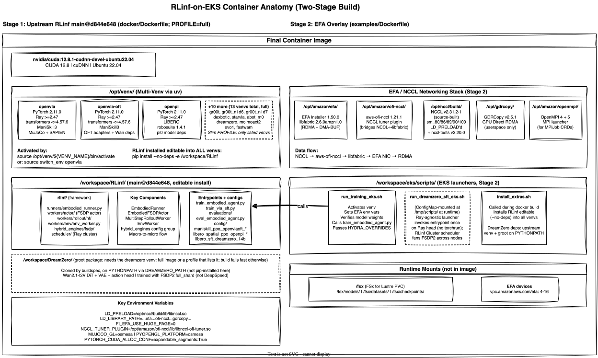

<!-- Copyright Amazon.com, Inc. or its affiliates. All Rights Reserved. -->
<!-- SPDX-License-Identifier: MIT-0 -->

# RLinf Reference Implementation

> **Framework**: RLinf main@d844e648 (post-v0.4, 2026-10-22) -- Reinforcement Learning (RL) Infrastructure for Embodied and Agentic AI
> **Paper**: Yu et al., "RLinf: Flexible and Efficient Large-scale RL via Macro-to-Micro Flow Transformation", arXiv:2509.15965, 2025
> **Code**: https://github.com/RLinf/RLinf
> **Docs**: https://rlinf.readthedocs.io/en/latest/

## What It Does

RLinf provides a flexible and scalable RL infrastructure for training Embodied and Agentic AI. It supports:

- **RL Algorithms**: GRPO (Group Relative Policy Optimization), PPO (Proximal Policy Optimization), DAPO, Reinforce++, SAC (Soft Actor-Critic), CrossQ, RLPD, SAC-Flow, DSRL, DAgger
- **Simulators**: ManiSkill, LIBERO, RoboTwin, CALVIN, RoboCasa, IsaacLab, MetaWorld, BEHAVIOR, Franka-Sim
- **Models**: OpenVLA, OpenVLA-OFT, pi0, pi0.5, GR00T, StarVLA, LingBot-VLA, Dexbotic
- **Training Backends**: FSDP (Fully Sharded Data Parallel) + HuggingFace/SGLang/vLLM, Megatron + SGLang/vLLM
- **Macro-to-Micro Flow Transformation**: Up to 2.434x throughput vs existing frameworks

## Container Build Strategy

We use a **two-stage build** that preserves upstream RLinf's dependency management while adding EFA (Elastic Fabric Adapter) networking for EKS (Elastic Kubernetes Service):

1. **Stage 1**: Build the upstream RLinf image using their `docker/Dockerfile` + `BUILD_TARGET` arg
2. **Stage 2**: Layer EFA/NCCL/GDRCopy networking stack on top via our `Dockerfile`

This gives us:
- **All upstream dependency management preserved** (uv, multi-venv, install.sh, model-specific isolation)
- **Multiple models per image** (e.g., `embodied-maniskill_libero` ships 13 venvs: openvla, openvla-oft, openpi, gr00t, gr00t_n1d6, gr00t_n1d7, dexbotic, starvla, abot_m0, dreamzero, molmoact2, evo1, fastwam)
- **EFA networking for multi-node NCCL (NVIDIA Collective Communications Library) on EKS**
- **Any `BUILD_TARGET` works** -- any upstream `embodied-*` (or `reason`) target in RLinf's `docker/Dockerfile` can be layered

The `switch_env` utility selects the active model at runtime:
```bash
source switch_env openvla      # OpenVLA
source switch_env openvla-oft  # OpenVLA-OFT
source switch_env openpi       # pi0
```

## Examples

Four of the examples run from the **same unified image** (`BUILD_TARGET=embodied-maniskill_libero`, pushed as `:latest`), which ships every venv they need; they differ only by `CONFIG_NAME`, `VENV_NAME` and `MODEL_PATH`. IsaacLab needs Isaac Sim and RT-core GPUs, so it uses the `isaaclab-gr00t` image profile (`:isaaclab-gr00t-latest`); π₀-FAST needs a Python 3.12 venv the full image does not ship, so it uses the `pi0-fast` profile (`:pi0-fast-latest`). For smaller per-example images, see "Build a slim image" in the main [README](../README.md).

| Example | Simulator | Algorithm | Model | Venv | Config | Default instance | Image |
|---------|-----------|-----------|-------|------|--------|------------------|-------|
| [ManiSkill + OpenVLA-OFT PPO](maniskill-openvlaoft-ppo/) | ManiSkill3 | PPO | OpenVLA-OFT | `openvla-oft` | `maniskill_ppo_openvlaoft` | 1x g7e.12xlarge (`gpu-sim`) | `:latest` |
| [LIBERO + pi0 PPO](libero-pi0-ppo/) | LIBERO | PPO | pi0 | `openpi` | `libero_spatial_ppo_openpi_quickstart` | 1x g7e.12xlarge (`gpu-sim`) | `:latest` |
| [Wan World Model GRPO](wan-openvlaoft-grpo/) | Wan (LIBERO-Spatial) | GRPO | OpenVLA-OFT | `openvla-oft` | `wan_libero_spatial_grpo_openvlaoft` | 1x p5en.48xlarge | `:latest` |
| [DreamZero SFT](dreamzero/) | LIBERO | SFT | DreamZero 14B (Wan2.1 backbone) | `dreamzero` | `libero_sft_dreamzero_14b` | 2x p5en.48xlarge | `:latest` |
| [IsaacLab GR00T PPO](isaaclab-gr00t-ppo/) | Isaac Lab (Isaac Sim 5.1) | PPO | GR00T N1.5 | `gr00t` | `isaaclab_franka_stack_cube_ppo_gr00t` | 1x g7e.24xlarge or g6e.24xlarge (`gpu-sim`) | `:isaaclab-gr00t-latest` |
| [LIBERO-10 π₀-FAST GRPO](libero-pi0fast-grpo/) | LIBERO-10 | GRPO | π₀-FAST (LeRobot) | `pi0_fast` | `libero_10_grpo_pi0_fast` | 2x p5en.48xlarge | `:pi0-fast-latest` |

## Compute Requirements

Per example, as shipped (each example README lists the alternatives):

| Example | GPUs | Node pool | EFA | Notes |
|---------|------|-----------|-----|-------|
| ManiSkill + OpenVLA-OFT PPO | 2x RTX PRO 6000 96 GB (g7e.12xlarge) | `gpu-sim` | No | p5en.48xlarge (8x H200) is the documented large-GPU alternative |
| LIBERO + pi0 PPO | 2x RTX PRO 6000 96 GB (g7e.12xlarge) | `gpu-sim` | No | Same alternative |
| Wan World Model GRPO | 8x H200 141 GB (p5en.48xlarge) | `gpu-training` | No (single node) | |
| DreamZero SFT | 16x H200 (2x p5en.48xlarge) | `gpu-training` | Yes, 16 per node | FSDP2 across nodes; plan >= 250 GB free on FSx (a 14B DCP checkpoint is ~207 GB on disk) |
| IsaacLab GR00T PPO | 4x RTX PRO 6000 or 4x L40S (g7e/g6e.24xlarge; .48xlarge also accepted) | `gpu-sim` | No | Isaac Sim needs RT-core GPUs (not A100/H100/H200) |
| LIBERO-10 π₀-FAST GRPO | 16x H200 (2x p5en.48xlarge) | `gpu-training` | Yes, 16 per node | ~50 min per GRPO step at the reference config |

The `gpu-sim` pool needs `enable_sim_pool = true` in the workloads layer. All examples share FSx for Lustre (`fsx-claim`) for model weights, datasets and checkpoints. A g6.8xlarge (~$1/hr) is enough to validate the infrastructure (L0-L4, EFA), not to train.

## Software Stack

| Layer | Component | Version |
|-------|-----------|---------|
| **Python** | uv-managed venvs | Python 3.11 (upstream `install.sh` default; set per venv) |
| **Framework** | PyTorch | 2.11.0+cu128 (upstream default) |
| **CUDA** | CUDA (Compute Unified Device Architecture) Toolkit | 12.8.1 |
| **RL Framework** | RLinf | main@d844e648 (post-v0.4) |
| **Distributed** | Ray | >=2.47.0 |
| **EFA** | EFA Installer | 1.50.0 (libfabric 2.6.0amzn1.0, aws-ofi-nccl 1.21.1) |
| **NCCL** | NCCL (source-built) | 2.31.2-1 (+ nccl-tests v2.20.0) |
| **Config** | Hydra / OmegaConf | Latest |
| **Tracking** | TensorBoard (default) | Latest |

## Container Anatomy

The training container is built in two stages:

- **Stage 1 (upstream RLinf)**: RL framework, training scripts, Hydra configs, simulators, multi-venv isolation. RLinf is a veRL fork with embodied-AI extensions (macro-to-micro flow, 2.4x throughput).
- **Stage 2 (this repo)**: AWS EFA networking stack for multi-node NCCL, EKS-specific launch scripts, the DreamZero `groot` checkout.



| Layer | Provides | Path |
|-------|----------|------|
| CUDA base | GPU drivers, cuDNN (CUDA Deep Neural Network library) | System |
| RLinf venvs | Per-model Python environments (openvla, openpi, etc.) | `/opt/venv/` |
| RLinf source | PPO training loop, Hydra configs, veRL workers | `/workspace/RLinf/` |
| DreamZero (`groot`) | Model code for the DreamZero example (on `PYTHONPATH` via `DREAMZERO_PATH`) | `/workspace/DreamZero/` |
| EFA stack | libfabric 2.6, aws-ofi-nccl 1.21.1, NCCL 2.31.2, nccl-tests, GDRCopy (GPU Direct RDMA Copy), OpenMPI | `/opt/amazon/`, `/opt/nccl/` |
| EKS scripts | Training launcher, install_extras | `/workspace/eks/scripts/` |
| Runtime mounts | Model weights, datasets, checkpoints, EFA devices | `/fsx/` (PVC (PersistentVolumeClaim)) |

## Training Metrics

RLinf writes [TensorBoard](https://www.tensorflow.org/tensorboard) event files to FSx as the default logger. Events are stored at `/fsx/checkpoints/<experiment>/tensorboard/`.

To view training metrics locally:

```bash
kubectl port-forward <training-pod> 6006:6006 -n rlinf &
tensorboard --logdir /fsx/checkpoints/<experiment>/tensorboard --port 6006
```

Or use `examples/scripts/plot_training_curve.py` to generate static PNG charts from completed runs.

For additional experiment tracking (run comparison, artifact management), enable the optional [MLflow addon](../infrastructure/README.md#mlflow-experiment-tracking).

## Directory Structure

```
examples/
├── Dockerfile                          # Stage 2: EFA overlay on the upstream image
├── Dockerfile.profile                  # Slim image profiles (on upstream embodied-common-image)
├── profiles.env                        # Profile definitions (venvs, assets)
├── buildspec.yml                       # CodeBuild: full image or a profile
├── README.md                           # This file
├── AGENTS.md                           # Agent notes: gotchas, pins, per-example details
├── diagrams/                           # Shared infrastructure + container diagrams
├── scripts/
│   ├── run_training_eks.sh             # Generic training launcher (any config)
│   ├── generate-showcase-video.sh      # Eval-video Job -> S3 -> showcase .mp4
│   ├── plot_training_curve.py          # TensorBoard events -> training curve PNG
│   ├── resolve_profile.sh              # PROFILE -> INSTALLS/ASSETS (buildspec.yml)
│   ├── install_extras.sh               # Conditional package installer for EXTRAS
│   └── upstream-build-patches/         # Optional patches for the upstream build
├── maniskill-openvlaoft-ppo/           # ManiSkill + OpenVLA-OFT PPO
├── libero-pi0-ppo/                     # LIBERO + pi0 PPO
├── wan-openvlaoft-grpo/                # Wan World Model GRPO (OpenVLA-OFT)
├── dreamzero/                          # DreamZero SFT -> convert -> eval (2 nodes)
├── isaaclab-gr00t-ppo/                 # IsaacLab GR00T N1.5 PPO (RT-core GPUs)
└── libero-pi0fast-grpo/                # LIBERO-10 pi0-FAST GRPO (2 nodes)
```

## Quick Start

The main [README](../README.md) Quick Start covers deploy, image build, container test and a first training run. Each example README then has its own steps (model download, launch, monitor). In short, for one example:

```bash
export NAMESPACE=rlinf
export IMAGE=$(terraform -chdir=infrastructure/build output -raw ecr_repository_url):latest   # or :<profile>-latest

# Stage model weights
envsubst '${NAMESPACE}' < examples/maniskill-openvlaoft-ppo/manifests/model-download.yaml | kubectl apply -f -
kubectl wait -n "$NAMESPACE" job/model-download-maniskill-openvlaoft --for=condition=complete --timeout=60m

# Launch (restricted envsubst: in-manifest shell variables must stay literal)
envsubst '${IMAGE} ${NAMESPACE}' < examples/maniskill-openvlaoft-ppo/manifests/maniskill-openvlaoft-ppo.yaml | kubectl apply -f -
kubectl logs -f -n "$NAMESPACE" job/rlinf-maniskill-openvlaoft
```

DreamZero (SFT → convert → eval) and IsaacLab (stage → smoke → train) have more steps (launcher ConfigMaps, staging jobs); follow their READMEs.

## Validation

The repo includes a layered validation harness that tests the full stack from static code checks to training step verification.

```bash
# Local validation (no cluster required)
./validate.sh --mode local

# Cluster validation (requires live EKS cluster)
./validate.sh --mode cluster --level 3    # Up to NCCL/EFA
./validate.sh --mode cluster --level 5    # Up to training steps
./validate.sh --mode cluster              # L0-L6 (L7 runs only when asked)

# L7: run every example README as written (the documented smoke edit only); results.tsv
# records image, instance type, Kubernetes version and step time per step
./validate.sh --mode cluster --skip-to 7 --level 7
L7_VIDEO=1 ./validate.sh --mode cluster --skip-to 7 --level 7 --example maniskill-openvlaoft-ppo

# Advanced
./validate.sh --mode cluster --skip-to 2  # Resume from L2
./validate.sh --mode cluster --level 5 --example maniskill-openvlaoft  # Single example
./validate.sh --mode cluster --continue-on-error  # Don't stop on failure
```

### Validation Levels (Cluster Mode)

| Level | Name | What it Tests | Approx Time |
|-------|------|---------------|-------------|
| L0 | Infrastructure | GPU, EFA devices, FSx mount | ~1 min |
| L1 | Container Build | CodeBuild two-stage image, ECR (Elastic Container Registry) push | ~45-50 min (measured 43–45 min on main@c70606f0; 48.6 min with EFA 1.50.0 + nccl-tests; build_timeout 150 min; `isaaclab-gr00t` ~100 min incl. push) |
| L2 | Container Test | 12 tests: CUDA, EFA libs, venvs, torch version, comms stack versions, Ray, MPI (Message Passing Interface) | ~2 min |
| L3 | NCCL/EFA | allreduce bandwidth threshold via MPIJob (p5en: full-node, >= 391 GB/s busbw at 16 GiB) | ~3-4 min |
| L4 | Model Download | HuggingFace model weights to FSx | ~30 min |
| L5 | Training Steps | 1 PPO step each for ManiSkill + OpenVLA-OFT and LIBERO + pi0 (x2) | ~30 min |
| L6 | Multi-Node | 2-node Ray cluster, 1 training step | ~10 min |
| L7 | Example READMEs | Each example's README steps run as written (`tests/lib/examples.sh`): ManiSkill, π₀, IsaacLab smoke + train on g-class; Wan, DreamZero SFT → convert → eval on p5en. Optional: showcase videos (`L7_VIDEO=1`), DreamZero staging (`L7_STAGE=1`) | ~3 h total; run examples in parallel with `--example` |

### Training Step Test (L5)

Uses the `runner.max_steps=1` Hydra override (`tests/manifests/training-step-test.yaml`, on the `gpu-training` pool) to run exactly 1 PPO step per example. Wan, DreamZero and IsaacLab are covered by L7 (their READMEs as written).

| Example | Venv | Config |
|---------|------|--------|
| ManiSkill + OpenVLA-OFT | `openvla-oft` | `maniskill_ppo_openvlaoft_quickstart` |
| LIBERO + pi0 | `openpi` | `libero_spatial_ppo_openpi_quickstart` |
