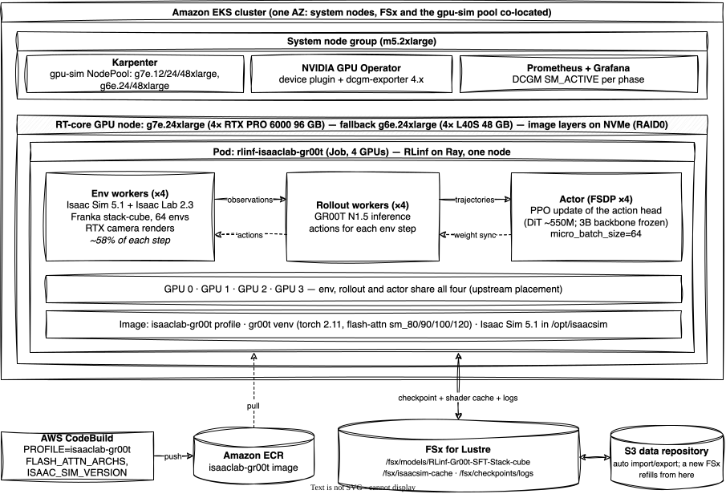
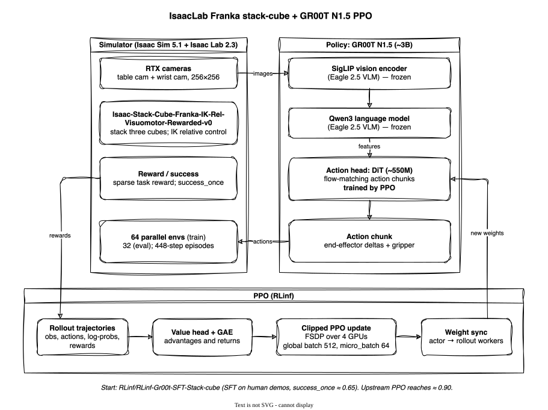

# IsaacLab Franka Stack-Cube + GR00T N1.5 PPO on Amazon EKS

> **Validated on one RT-core node (2026-11):** 5 PPO steps + eval on g7e.24xlarge, g6e.24xlarge and g5.12xlarge; eval `success_once` reproduces the SFT baseline. **Recommended: g7e.24xlarge (4× RTX PRO 6000), ~128 s per PPO step, ~$0.59 per step on-demand.** See [Results](#results).

This example runs RLinf's validated recipe for **Isaac Lab** with **NVIDIA GR00T N1.5**: PPO fine-tuning of an SFT policy on the Franka stack-cube task. Upstream reports `success_once` going from **0.654 after SFT to 0.897 after RL** ([RLinf IsaacLab docs](https://rlinf.readthedocs.io/en/latest/rst_source/examples/embodied/isaaclab.html)).

It's also the first example in this repo whose simulator **needs RT-core GPUs**. Isaac Sim 5.1 does not support GPUs without RT cores (A100, H100, H200), so it runs on a dedicated **g-class Karpenter pool** (`gpu-sim`) rather than on p5en.

## Why Isaac Sim 5.1 (not 6.x)

RLinf's IsaacLab integration (the [`RLinf/IsaacLab`](https://github.com/RLinf/IsaacLab) fork, Isaac Lab 2.3) targets Isaac Sim 5.1. Isaac Sim 6.x requires Isaac Lab 3.0, which reorganised its tasks. RLinf's `Isaac-Stack-Cube-Franka-IK-Rel-Visuomotor-Rewarded-v0` task does not exist there, and RLinf has not ported to it yet.

## RLinf-first vs Isaac Lab-first

There are two separate "RLinf + Isaac Lab" integrations, maintained by different projects:

| | **RLinf-first** (this example) | **Isaac Lab-first** ([Isaac Lab v3 docs](https://isaac-sim.github.io/IsaacLab/v3.0.0-EA/source/experimental-features/rlinf_vla_posttraining.html)) |
|---|---|---|
| Owner | RLinf (`rlinf/envs/sim/isaaclab/` + the `RLinf/IsaacLab` fork) | Isaac Lab (`isaaclab_contrib/rl/rlinf/`, `isaaclab train --rl_library rlinf`) |
| Install | RLinf `install.sh --model gr00t --env isaaclab` installs Isaac Lab into an RLinf venv | Isaac Lab env + `uv pip install rlinf==0.2.0dev2 ... --no-deps` + pinned Isaac-GR00T |
| Stack | Isaac Sim 5.1 / Isaac Lab 2.3, Python 3.11 | Isaac Sim 6.2 / Isaac Lab 3.0, Python 3.12, torch 2.11, numpy ≥ 2 |
| RLinf version | current (this repo pins RLinf main) | `0.2.0dev2` (pre-v0.3) |
| Reference task | Franka stack-cube, GR00T N1.5 / π₀.₅, published RL results | G1 + Dex3 `assemble_trocar`, GR00T N1.5 |

**Which to choose:**
- If **Isaac Lab is your center of gravity** (your own tasks and robots, the newest Isaac Sim, NVIDIA tooling), use **Isaac Lab-first**. Expect an older RLinf.
- If **RLinf is your center of gravity** (several simulators, current RLinf algorithms such as PPO/GRPO/OPD/SAC, multi-node scaling on EKS), use **RLinf-first**, as this example does. Today that means Isaac Sim 5.1.

The EKS pieces here are the same for both, because both need RT-core GPUs:
- the `gpu-sim` pool
- Isaac Sim in the image (or staged on FSx as a fallback) and the shader cache on FSx
- the GPU Operator gdrcopy note in [Troubleshooting](#troubleshooting) (only for clusters not built from this repo; the addons layer already sets it)

## Architecture



| Component | Where | Notes |
|---|---|---|
| Image | `isaaclab-gr00t` profile (`examples/profiles.env`) | One `gr00t` venv built with `--env isaaclab` (Isaac Lab 2.3; torch 2.11.0+cu128) plus Isaac Sim, 22.5 GB compressed in ECR. flash-attn is rebuilt for sm_80/90/100/120 (`FLASH_ATTN_ARCHS`), so one image runs on A10G, L40S, H100/H200, B200 and RTX PRO 6000 |
| Isaac Sim 5.1 | In the image, `/opt/isaacsim` | Standalone install (19 GB unpacked) baked in at build time (`ISAAC_SIM_VERSION=5.1.0`, `ACCEPT_ISAAC_SIM_EULA=Y`), like NVIDIA's own `isaac-sim` containers. Your build downloads it into your private ECR; nothing is redistributed. Optional instead: stage it on FSx with `stage-isaacsim.yaml` (`ISAAC_PATH=auto` uses the image copy if present, else FSx) |
| Shader / kit cache | FSx `/fsx/isaacsim-cache` | ~1 GB, shared across nodes; first boot compiles shaders (~80 s extra) |
| SFT checkpoint | FSx `/fsx/models/RLinf-Gr00t-SFT-Stack-cube` | `RLinf/RLinf-Gr00t-SFT-Stack-cube`, 7.6 GB. The Eagle VLM backbone ships inside the gr00t package |
| GPU node | `gpu-sim` NodePool: **g7e.24xlarge** (4× RTX PRO 6000 96 GB) or **g6e.24xlarge** (4× L40S 48 GB). Image layers and pod scratch on the NVMe instance store (`instanceStorePolicy: RAID0`; 2×3.8 TB on g7e.24xlarge) | 4 GPUs; env workers (Isaac Sim), rollout and actor all on GPUs 0-3 (upstream's placement) |

Only GR00T's action head (DiT, ~550M parameters) trains; the ~3B Eagle backbone is frozen. That is why 4 GPUs are enough and a bigger trainer brings little: on g7e, about 58% of each step is Isaac Sim rollouts.



## Prerequisites

- The cluster and storage layers from the main [README](../../README.md).
- A `gpu-sim` NodePool for RT-core GPUs: `enable_sim_pool = true` in the workloads layer. Default instance types: g7e.24/48xlarge, g6e.24/48xlarge.
- **dcgm-exporter 4.x** if you want GPU profiling metrics (SM_ACTIVE) on Blackwell GPUs (the addons layer sets `dcgm_exporter_version`).
- **NVIDIA GPU Operator:** the addons layer sets `gdrcopy.enabled=false`. On a cluster not built from this repo, if `ClusterPolicy.spec.gdrcopy.enabled` is `true` while the AMI manages the driver (`driver.enabled: false`), g4dn/g5 nodes never get allocatable GPUs. See [Troubleshooting](#troubleshooting).
- **NVIDIA license:** building the image with `ACCEPT_ISAAC_SIM_EULA=Y` (or staging Isaac Sim on FSx), and setting `OMNI_KIT_ACCEPT_EULA=YES` in the pods, means you accept the [NVIDIA Isaac Sim / Omniverse license](https://docs.isaacsim.omniverse.nvidia.com/latest/common/NVIDIA_Omniverse_License_Agreement.html). The manifests also set `PRIVACY_CONSENT=Y`, which opts in to Omniverse telemetry/data collection; remove it to opt out.

## Run it

```bash
# 0. Infrastructure with the gpu-sim pool (pick a region that offers g7e or g6e;
#    infrastructure/cluster/profiles/sim-training.tfvars is an example profile)
TF_VAR_enable_sim_pool=true ./infrastructure/deploy.sh --action apply --layer all --profile sim-training

export NAMESPACE=rlinf
export IMAGE=$(terraform -chdir=infrastructure/build output -raw ecr_repository_url):isaaclab-gr00t-latest

# 1. Build the image profile (~80 min; the flash-attn rebuild for Blackwell is most of it).
#    ACCEPT_ISAAC_SIM_EULA=Y accepts the NVIDIA Isaac Sim license; Isaac Sim is downloaded into your image.
aws codebuild start-build --project-name $(terraform -chdir=infrastructure/build output -raw codebuild_project_name) \
  --environment-variables-override name=PROFILE,value=isaaclab-gr00t,type=PLAINTEXT \
    'name=FLASH_ATTN_ARCHS,value=8.0;9.0;10.0;12.0,type=PLAINTEXT' \
    name=ISAAC_SIM_VERSION,value=5.1.0,type=PLAINTEXT name=ACCEPT_ISAAC_SIM_EULA,value=Y,type=PLAINTEXT

# 2. Stage the SFT checkpoint on FSx (once; FSx exports it to its S3 data repository)
envsubst '${NAMESPACE}' < examples/isaaclab-gr00t-ppo/manifests/model-download.yaml | kubectl apply -f -
#    (only if your image was built without ISAAC_SIM_VERSION: stage Isaac Sim on FSx instead)
# envsubst '${NAMESPACE}' < examples/isaaclab-gr00t-ppo/manifests/stage-isaacsim.yaml | kubectl apply -f -

# 3. (Optional) Smoke test: Isaac Sim boot + env stepping + camera frames, no training
kubectl -n $NAMESPACE create configmap isaaclab-smoke \
  --from-file=isaaclab_smoke.py=examples/isaaclab-gr00t-ppo/scripts/isaaclab_smoke.py --dry-run=client -o yaml | kubectl apply -f -
envsubst '${IMAGE} ${NAMESPACE}' < examples/isaaclab-gr00t-ppo/manifests/isaaclab-smoke.yaml | kubectl apply -f -

# 4. PPO training (defaults: g7e.24xlarge or g6e.24xlarge, 4 GPUs, actor.micro_batch_size=64)
envsubst '${IMAGE} ${NAMESPACE}' < examples/isaaclab-gr00t-ppo/manifests/isaaclab-gr00t-ppo.yaml | kubectl apply -f -
kubectl logs -f job/rlinf-isaaclab-gr00t -n $NAMESPACE   # also tee'd to /fsx/checkpoints/logs/<job>/
```

## Customize for your own embodiment and task

The recipe follows the usual path: SFT on demonstrations, then RL in simulation. To use your own robot, data and task:

1. **Task.** Implement an Isaac Lab task (scene, robot, cameras, rewards, success and termination) and register it with gym. RLinf's wrapper lives under `rlinf/envs/sim/isaaclab/tasks/` (see `stack_cube.py`) and is registered in `rlinf/envs/sim/isaaclab/__init__.py`. Point `env.train.init_params.id` / `env.eval.init_params.id` at your task id.
2. **Robot and cameras.** Bring your robot's USD/URDF into the Isaac Lab scene config. Camera names and sizes (`init_params.table_cam`, `wrist_cam`) must match what your policy expects.
3. **Observations and actions.** `actor.model.obs_converter_type` maps simulator observations to GR00T inputs, and `embodiment_tag` / `num_action_chunks` set the action space. Add a converter for your embodiment.
4. **SFT checkpoint.** Start RL from a policy fine-tuned on your demonstrations (`actor.model.model_path`, `rollout.model.model_path`). The upstream checkpoint was trained on [`RLinf/IsaacLab-Stack-Cube-Data`](https://huggingface.co/datasets/RLinf/IsaacLab-Stack-Cube-Data).
5. **Reward and success.** `use_rel_reward`, `reward_coef` and your task's success term drive PPO. `env/success_once` is the main metric.
6. **Scale.** Per GPU, 64 envs used 9.7 of 23 GB on an A10G in the smoke test. Size `env.train.total_num_envs` and `cluster.component_placement` for your GPUs. On a single node the step is simulation-bound (see [Results](#results)), so more simulation capacity across nodes is the next lever; that topology is not covered here yet.

## Results

PPO on one node, 64 training envs, 4 GPUs (env workers, rollout and actor all on GPUs 0-3), 2-step runs unless noted. Step times from RLinf's per-step timers; GPU core use (`SM_ACTIVE`, fraction of cycles an SM has work) from DCGM. Measured 2026-10/11; on-demand prices in us-east-2 (g5 in ap-southeast-3).

| Instance | GPUs | Batch | Step (s) | Training (s) | Rollouts (s) | Training SM_ACTIVE | $/hr | $/step |
|---|---|---|---|---|---|---|---|---|
| **g7e.24xlarge** | 4× RTX PRO 6000 96 GB | 64 | **128** | **47** | 74 | 0.29 | 16.57 | **~0.59** |
| g6e.24xlarge | 4× L40S 48 GB | 64 | 253 | 151 | 93 | 0.29 | 15.07 | ~1.06 |
| g5.12xlarge | 4× A10G 24 GB | 32 (+ actor offload) | 578 | 392 | 170 | 0.38 | 7.94 | ~1.27 |

**Evaluation** (5 PPO steps, eval at step 5, 96 trajectories; `success_once`):

| | g7e.24xlarge | g6e.24xlarge | g5.12xlarge | Upstream SFT checkpoint |
|---|---|---|---|---|
| eval `success_once` | 0.635 | 0.521 | 0.646 | 0.654 |

Five steps cannot show RL improvement; these runs validate the pipeline. The 95% interval for 96 trajectories is about ±0.10, so all four agree with the SFT baseline. Upstream reaches 0.897 after a long RL run.

What the measurements show:
- **Use 4 GPUs.** On L40S, 4 GPUs were faster than 8 at batch 64 (training 151 vs 166 s); with batch 32 they were equal. Only the ~550M-parameter action head trains, so spreading the actor over 8 PCIe GPUs only adds communication.
- **Use `actor.micro_batch_size=64`.** Batch 128 gained 0–5% on g6e and g7e. On 24 GB A10G: `actor.micro_batch_size=32 actor.enable_offload=True` without eval; `actor.micro_batch_size=8 actor.enable_offload=True` with eval (`runner.val_check_interval > 0`), since batch 32 with eval does not fit (eval envs are created at start-up).
- **The step is simulation-bound on g7e**: Isaac Sim rollouts are ~58% of the step. Faster training GPUs change little; more simulation capacity would.
- **Attention backend does not matter** for this model: flash-attn and PyTorch SDPA gave the same step time on g7e (training 48 vs 46 s).

**Container test (L2)** on the image with Isaac Sim baked in: 12/12 checks pass (CUDA, EFA/NCCL libraries, `gr00t` venv with torch 2.11, Ray, OpenMPI, FSx); 22.5 GB image pulled in ~4 min onto NVMe.

**2-step PPO on the same image** (g5.24xlarge, 4× A10G, batch 32 + actor offload, `ISAAC_PATH=auto` → `/opt/isaacsim`): 558 s per step (training 380 s, rollouts 162 s), in line with the 578 s measured with Isaac Sim on FSx. On g7e (4 of 8 GPUs on a g7e.48xlarge, batch 64): 136 s per step, with rollouts unchanged (75 s).

**Isaac Sim smoke test** (16 envs, 100 steps, warm cache):

| GPU | Isaac Sim boot | env create + reset | env-steps/s | GPU memory |
|---|---|---|---|---|
| L40S (g6e), Isaac Sim in the image, NVMe node | 20 s | 5.0 s | 257 | — |
| L40S (g6e), Isaac Sim on FSx | 79 s | 7.8 s | 243 | 6.6 GB |
| A10G (g5) | 65 s | 9.9 s | 159 | 5.9 GB |

## Troubleshooting

| Symptom | Cause | Fix |
|---|---|---|
| g5/g4dn node is Ready but `nvidia.com/gpu` is never allocatable; `nvidia-operator-validator` stuck in `gdrcopy-validation` (`lsmod \| grep gdrdrv` retrying) | The EKS AL2023 GPU AMI forces the **proprietary** driver on g4dn/g5 (GSP off) and only ships `gdrdrv.ko` for the open flavor. With `driver.enabled: false`, GPU Operator `gdrcopy.enabled: true` installs nothing; it only adds this validator gate | The addons layer sets `gdrcopy.enabled=false`. On a cluster not built from this repo, set `ClusterPolicy.spec.gdrcopy.enabled: false`. On p5en the AMI still loads gdrdrv itself, and EFA GPUDirect RDMA does not depend on it |
| Log noise: `carb.launcher ... failed to fork the child process ... Resource temporarily unavailable`, GLFW / X display warnings | Isaac Sim helper processes (`nvidia-smi -q`, telemetry) in a container, and headless mode | Harmless |
| First boot is slow (~2.5 min) | Shader compilation | Expected once; the cache on FSx brings later boots to ~65 s |
| `CUDA error: no kernel image is available for execution on the device` in `flash_attn_gpu.fwd` on RTX PRO 6000 (g7e) | The prebuilt flash-attn 2.8.3 wheel has only sm_80 and sm_90 kernels. L40S (sm_89) runs the sm_80 code; Blackwell (sm_120) cannot | Build the image with `FLASH_ATTN_ARCHS=8.0;9.0;10.0;12.0` (adds ~60 min; keep `FLASH_ATTN_MAX_JOBS` ≤ 6 on a 145 GB build host, 16 runs out of memory). The buildspec sets this by default for `PROFILE=isaaclab-gr00t` |
| `flash_attn` imports but training fails on a new GPU type | An import does not touch the GPU | Run one attention call in the smoke test before training |
| No `DCGM_FI_PROF_*` (SM_ACTIVE) metrics on RTX PRO 6000; exporter logs `Not collecting DCP metrics: ... module of DCGM that is not currently loaded` | dcgm-exporter 3.3.x (GPU Operator v24.9 default) cannot load DCGM's profiling module on Blackwell | dcgm-exporter 4.x (`4.6.1-4.8.4-distroless`, addons `dcgm_exporter_version`). Note: 4.x labels the node `hostname`, 3.x `Hostname` |
| First Isaac Sim boot from FSx takes ~20 min (FSx-staged Isaac Sim only) | A new FSx with an S3 data repository loads file contents lazily on first read | Bake Isaac Sim into the image (default). If you stage it on FSx, prefetch after creating FSx (`find /fsx/isaacsim/5.1.0 -type f \| xargs -P 48 cat > /dev/null`, ~10 min for 18 GB) |
| Batch 32 + eval runs out of GPU memory on 4× A10G | Eval envs are created at start-up when `runner.val_check_interval > 0`, on top of Isaac Sim, rollout and actor | `actor.micro_batch_size=8 actor.enable_offload=True` on A10G, or a larger GPU |
| Training pod Pending for hours; `InsufficientInstanceCapacity` in the Karpenter log | On-demand g6e/g7e capacity is often unavailable in an AZ | List several instance types and AZs (`sim_instance_types`, `gpu_any_az`), or use a reservation; see [Scarce GPU capacity](../../infrastructure/AGENTS.md#scarce-gpu-capacity) |
| Slow pod start on a new node (image pull + unpack) | A large image unpacked on the gp3 root volume (250 MB/s) | `instanceStorePolicy: RAID0` in the EC2NodeClass puts containerd/kubelet on the NVMe instance store (set in this repo's workloads layer) |
